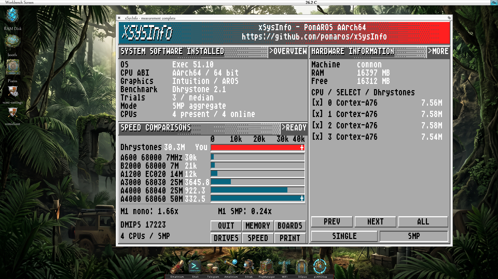

# xSysInfo for PomAROS 0.1.0 — PomAROS / Raspberry Pi preview

First public PomAROS application prerelease, based on Stefan Reinauer's
[xSysInfo](https://github.com/reinauer/xSysInfo). Thank you to Stefan and the
upstream contributors, and to Reinhold P. Weicker for Dhrystone.

## Download and run

`xSysInfo-0.1.0-pomaros-native-aarch64-smp.zip` contains the native application,
licence notices, build metadata and instructions. Check the archive against
`SHA256SUMS`, extract it, and copy the application directory to your PomAROS or compatible AROS AArch64 SMP
volume. From an AROS Shell in that directory:

```text
protect xSysInfo +e
xSysInfo
xSysInfo CLI
xSysInfo FULL SMP >RAM:xSysInfo.txt
```

The GUI offers SINGLE/SMP, CPU selection, SPEED/CANCEL, inventory views and
report export. PRINT writes `RAM:xSysInfo.txt`. The application does not install
an OS or drivers. Source archives are available with this release; build and
extension instructions are in [the porting guide](https://github.com/pomaros/xSysInfo/blob/pomaros-v0.1.0/aros/PORTING.md).

## Included

- Native C AArch64 system inventory and reentrant Dhrystone 2.1.
- Single-core and SMP measurements with independent worker state, a shared
  timing window, three trials and the median aggregate result.
- Classic bitmap logo, dithered panels, centered buttons and a fixed-size window.
- Six preserved Amiga reference scores on a fixed graph scale. Overflow is
  marked `+`; the M1 single-core/SMP ratios appear separately.
- Measured M1 reference reports and protocol documentation in the source tree.

## Compatibility and qualification

The executable targets the **native AROS AArch64 SMP ABI**. The original
release executable was tested on a MacBook Air M1 (2020), PomAROS Exec 51.12,
and was subsequently **reported working without recompilation on real
Raspberry Pi 500+ and Pi 3B+ hardware** running AROS AArch64 SMP. The Pi screenshot
shows Exec 51.10, four Cortex-A76 CPUs and a completed four-worker SMP result.
The exact OS distribution/build identifiers for the two physical Pi systems
have not been supplied.

| Running system | Evidence |
|---|---|
| PomAROS native M1 | Original executable: SINGLE/SMP, inventory, GUI and export exercised |
| Raspberry Pi 500+ / AROS AArch64 SMP | Original executable: user-reported operation; supplied screenshot shows completed SMP benchmark |
| Raspberry Pi 3B+ / AROS AArch64 SMP | Original executable: user-reported operation |
| Official upstream 2026-10-30 `raspi-aarch64-smp`, QEMU raspi3b | Original executable: SINGLE/SMP, inventory and GUI open/close passed |
| Another Apple model or Pi OS build | Requires validation with that runtime |
| AROS AArch64 UP or ARM32 | Requires a separate matching build; this archive uses the AArch64 SMP ABI |
| Raspberry Pi OS / Linux, macOS | Different OS ABI |



**Existing release updated in place:** the refreshed executable recognizes the
upstream `aarch64-raspi` identifier instead of displaying `common`, and reads
`/model` through `openfirmware.resource`. The full model appears in the inventory;
the dashboard uses an abbreviated display name. If the resource/property is
absent or invalid, the Pi family remains identified and the model is unavailable.
No OS or driver changes are required. Re-download the ZIP and its `SHA256SUMS`
together; checksums differ from the initial upload.

The physical M1/Pi reports concern the original executable. The refreshed
executable passed a separate upstream QEMU check of model detection, SINGLE/SMP
and GUI open/close; those original hardware observations
do not constitute a physical retest of the refreshed build. The archived M1
references retain their original executable and measurement provenance.

The release tag and GitHub-generated source archives describe the initial upload.
For the refreshed binary, use the attached `xSysInfo-0.1.0-updated-source.tar.gz`
and the exact source commit recorded in `build-info.json`.

## Validation and limitations

Host inventory/provider and benchmark engine tests run under ASan/UBSan.
The [compatibility record](https://github.com/pomaros/xSysInfo/blob/pomaros/aros/compatibility/upstream-qemu.md)
distinguishes the original binary's QEMU evidence, physical user reports and
refreshed-binary validation. Emulated scores are not hardware performance
references. Other runtime combinations require validation; this prerelease has
no comprehensive ABI guard.

Frequency and thermal conditions of the saved M1 references were not
independently measured; those values describe observed PomAROS performance,
not the M1's theoretical maximum. Memory bandwidth, floating-point and disk
throughput benchmarks are not implemented. CPU numbering currently assumes
contiguous online IDs and a maximum of 256 CPUs.

The ZIP includes component notices. SDK libraries and runtime helpers retain
their own licences; the application does not relicense them. Build metadata
identifies the common-core source and the shipped executable's SHA-256.
